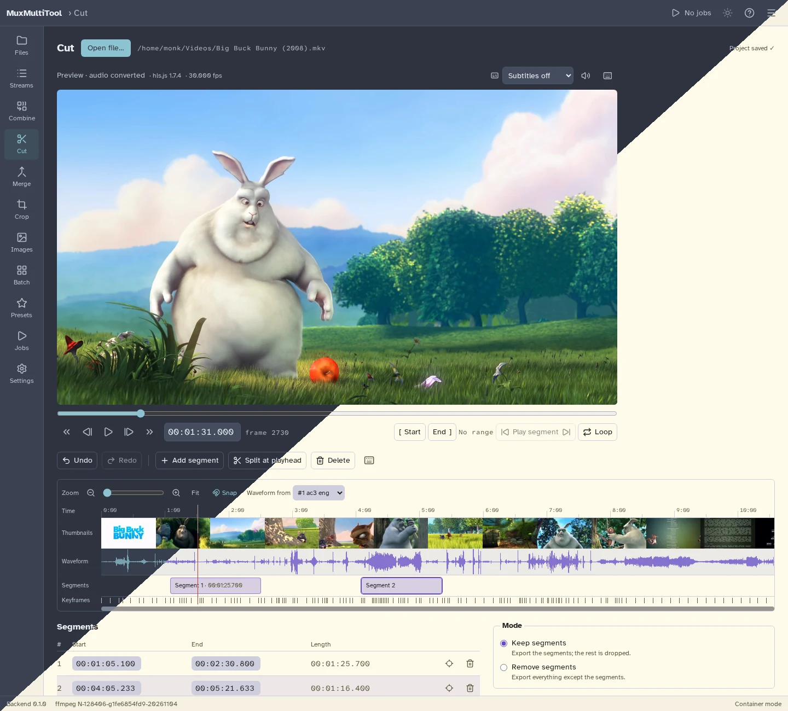
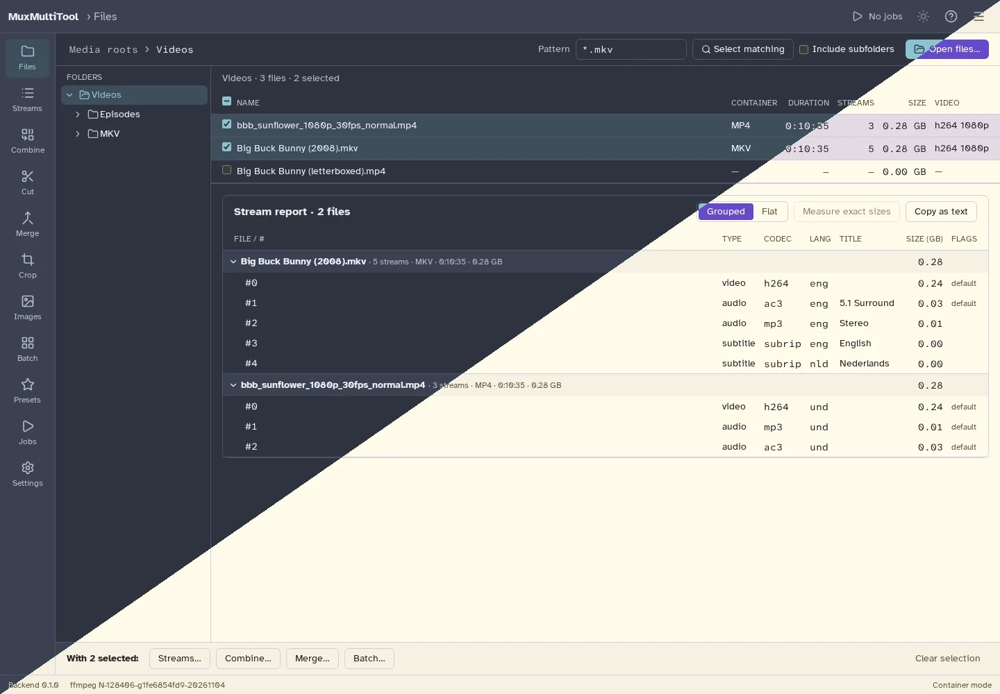
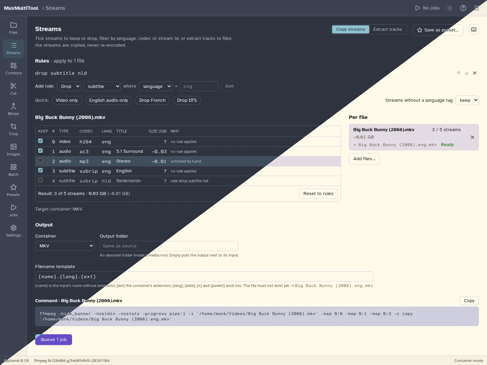
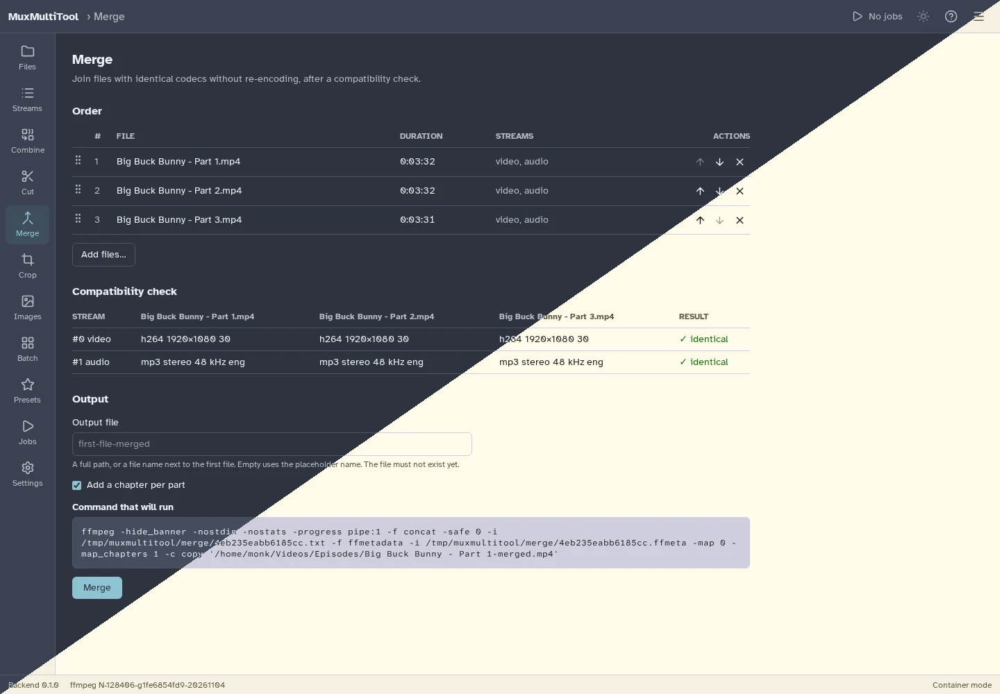
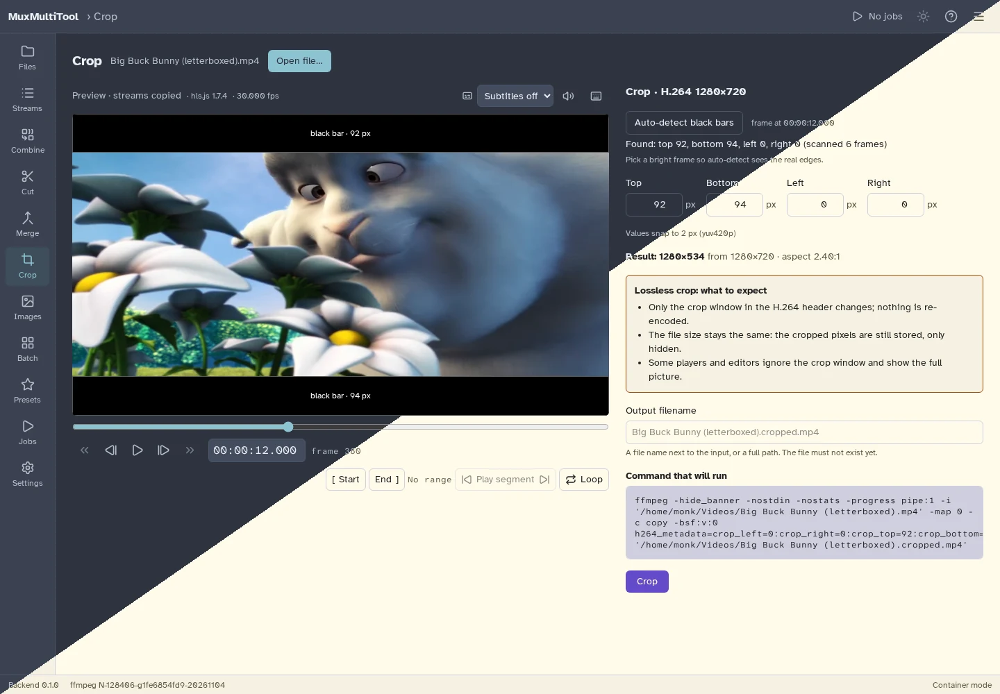
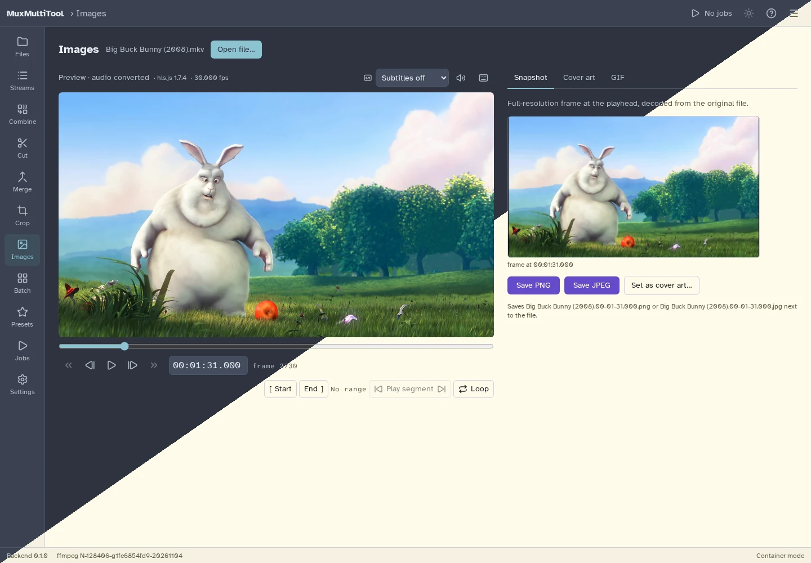
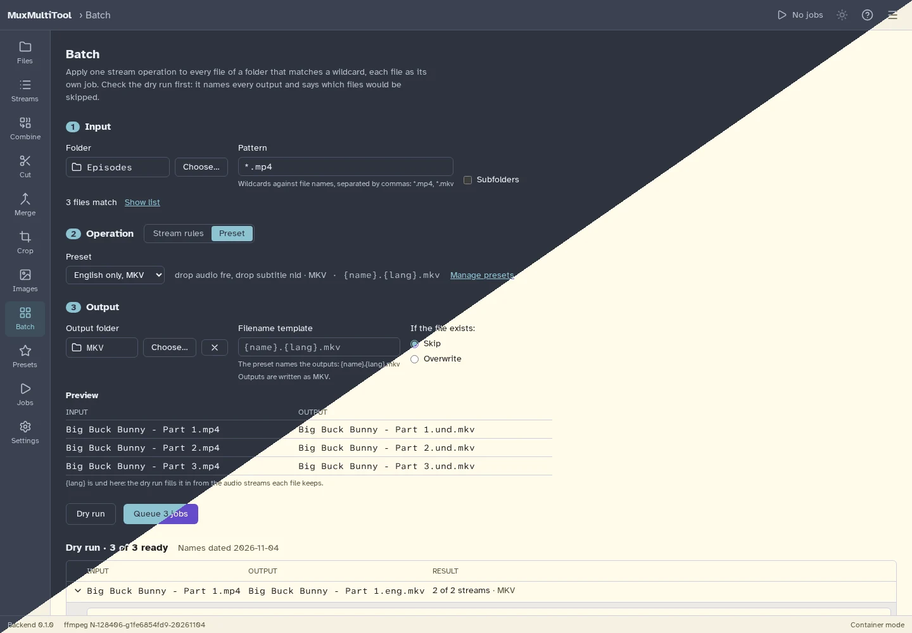
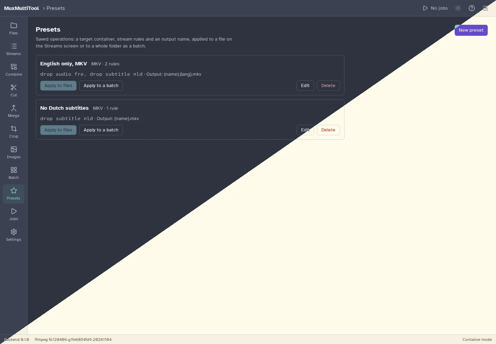
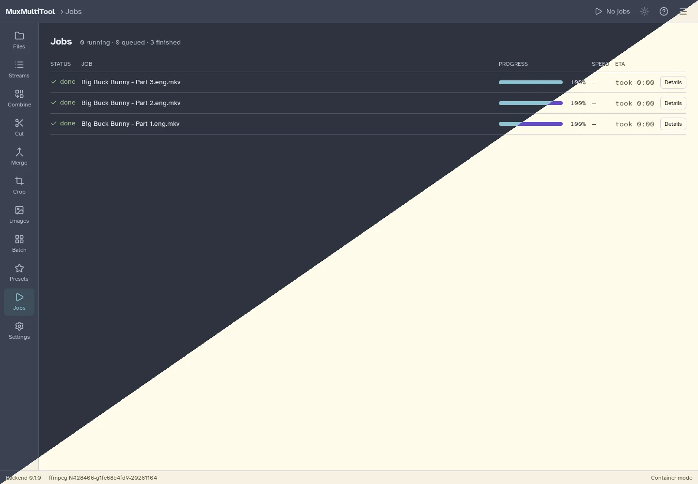
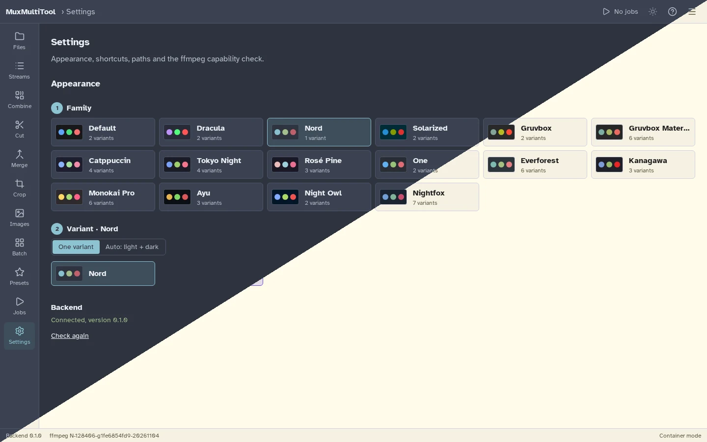

# MuxMultiTool

A self-hostable ffmpeg GUI for lossless video work: cut, remux, pick streams, merge and combine files without re-encoding them. It runs as a container with a web interface, or as a desktop app for Windows, macOS and Linux.

Every operation shows the exact ffmpeg command before it runs, and runs as a job you can follow, cancel and inspect.

## Features

- **Files:** browse the media folders, select files by hand or by wildcard, and see every stream of every file: codec, language, title, flags and size.
- **Streams:** keep or drop streams by hand or with rules (by language, codec or stream id), remux to MKV, MP4, MOV, WebM and more, or extract every track to its own file.
- **Combine:** build one file from streams of several files, with per-track language, title, default and forced flags, and a time offset per source.
- **Cut:** a zoomable timeline with thumbnails, waveform and keyframes. Keep or remove segments, cut on keyframes, normally, or frame-accurately with smart cut (only the frames around a cut are re-encoded). Split by duration, size or number of parts. Undo and redo, and the segments are saved per file.
- **Merge:** join files with identical codecs after a compatibility check, with a chapter per part.
- **Crop:** detect black bars and crop them losslessly from H.264 and H.265 video, by value or by dragging the edges on the picture.
- **Images:** save a snapshot of a frame, set a frame as cover art, make a GIF from a range within sensible limits, and turn a GIF into MP4 or WebM.
- **Batch:** apply one operation to every matching file in a folder, with output names from a template such as `{name}.{lang}.{ext}`. A dry run shows every output name and stream first.
- **Presets:** save an operation (container, stream rules, output name) and apply it to a file or a batch in one step.
- **Jobs:** a queue with live progress, the ffmpeg log, plain-language errors and cancel.
- **Themes:** 16 theme families with light and dark variants that can follow the system.

## Screenshots

Each screenshot is split diagonally between two of the themes: Nord (dark) and Dracula's Alucard (light).

### Files and stream report

### Stream selection

### Merge

### Lossless crop

### Images

### Batch

### Presets

### Jobs

### Themes

## Development

Building, running and configuring MuxMultiTool, and how its services work, is described in [development.md](development.md).

## License

MuxMultiTool is licensed under the [GNU General Public License v3.0 or later](https://www.gnu.org/licenses/gpl-3.0.html).

SPDX-License-Identifier: GPL-3.0-or-later

The app icon is the director's chair from [Streamline](https://github.com/webalys-hq/streamline-vectors)'s Pixel icons, licensed under [CC BY 4.0](https://creativecommons.org/licenses/by/4.0/), recoloured with the Gruvbox palette.

The screenshots show [Big Buck Bunny](https://peach.blender.org/), © 2008 Blender Foundation, licensed under [CC BY 3.0](https://creativecommons.org/licenses/by/3.0/).
